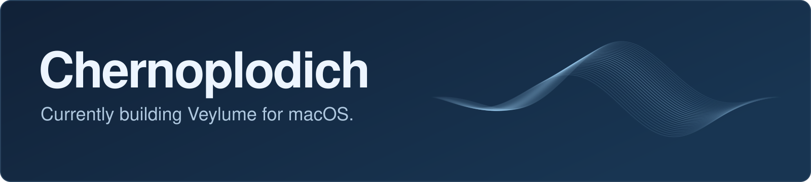

<picture>
  <source media="(max-width: 600px) and (prefers-color-scheme: dark)" srcset="assets/profile-header-mobile-dark-v2.svg">
  <source media="(max-width: 600px) and (prefers-color-scheme: light)" srcset="assets/profile-header-mobile-light-v2.svg">
  <source media="(prefers-color-scheme: dark)" srcset="assets/profile-header-dark-v2.svg">
  <source media="(prefers-color-scheme: light)" srcset="assets/profile-header-light-v2.svg">
  
</picture>

 

### [Veylume](https://github.com/Chernoplodich/Veylume)

**Local voice typing for Mac.**

Hold a shortcut, speak, and release to insert the text into the app you're using.
Speech recognition runs on your Mac and works offline after the model download.

  
  &nbsp;
  <a href="https://github.com/Chernoplodich/Veylume"><picture><source media="(prefers-color-scheme: dark)" srcset="assets/source-dark.svg"><source media="(prefers-color-scheme: light)" srcset="assets/source-light.svg"></picture></a>

Apple silicon, macOS 14 or later. The current release is an early preview. [Installation guide](https://github.com/Chernoplodich/Veylume/blob/main/docs/installation.md).

Built with Swift, SwiftUI and AppKit. Free and open source under the MIT license.

---

If you try it, I'd like to hear which apps you use it with and where text insertion doesn't work. [Open an issue](https://github.com/Chernoplodich/Veylume/issues/new/choose).
